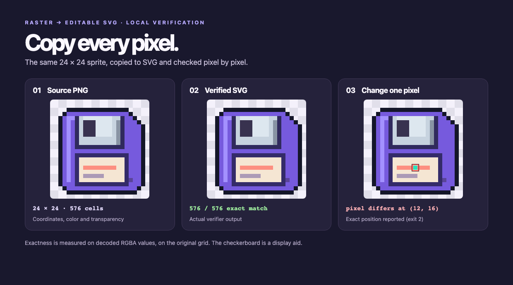

# Pixelify Anything

**Copy every pixel. Verify every pixel.**



Turn a local PNG, JPEG, or WebP into editable SVG without redrawing it. Each decoded pixel becomes a 1×1 rectangle with the same coordinates, color, and alpha. Pixelify Anything checks each cell before writing the output and refuses to save if anything differs. No AI, no image uploads.

## Try it

| Input | Output | Proof |
| :--- | :--- | :--- |
| [24×24 PNG sprite](examples/sprite-24.png) | [576 SVG rectangles](examples/sprite-24.svg) | [576 / 576 cells match](examples/sprite-24.result.json) |

Requires Python 3.10+ and Pillow. These commands use a macOS or Linux shell.

```sh
git clone https://github.com/taejs/pixel-eye.git
cd pixel-eye
python3 -m venv .venv
source .venv/bin/activate
python -m pip install -r requirements.txt

python pixel_eye.py examples/sprite-24.png eye-rebuilt.svg
python verify_pixels.py examples/sprite-24.png eye-rebuilt.svg
cmp examples/sprite-24.svg eye-rebuilt.svg
```

```json
{"decoded_pixels": 576, "matched_rect_cells": 576, "mismatches": 0, "omitted_transparent_cells": 0}
```

Change a single rectangle's fill and the verifier reports its exact coordinates. [Reproduce a one-pixel failure →](CONTRIBUTING.md#reproduce-a-one-pixel-failure)

## Options

- `--mode run` merges only horizontally adjacent pixels with identical RGBA.
- `--alpha omit-transparent` drops fully transparent cells. Pass `--omit-transparent` to the verifier when using this mode. Default mode preserves their hidden RGB.
- The tool accepts still images within 32 MiB and 4,194,304 decoded pixels. It never overwrites an existing output.

**What “exact” means.** The decoded pixels match on the input grid. This does not reverse JPEG compression, recover a hidden low-resolution sprite, change the art style, or reproduce a color-managed screen rendering. See the [output contract](docs/limits.md).

[Contributing](CONTRIBUTING.md) · [Changelog](CHANGELOG.md) · [Project examples](examples/)
