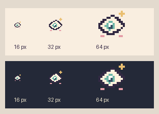

# Pixel Eye



**픽셀은 그대로. 좌표도, 색도, 투명도도.**

Pixel Eye는 로컬 PNG·JPEG·WebP 하나를 받아, 디코딩한 픽셀을 **같은 좌표와 RGBA의 SVG 사각형**으로 옮깁니다. 기본은 한 픽셀당 1×1 사각형 하나. 변환기는 결과를 다시 읽어 입력과 대조하고, 차이가 나면 출력 파일을 저장하지 않습니다. 이미지 업로드나 AI 호출은 없습니다.

## 실제 예시

| 원본 PNG | 출력 SVG | 검사 결과 |
| :--- | :--- | :--- |
| [16×16 눈 픽셀](examples/eye-16.png) | [1×1 사각형 256개](examples/eye-16.svg) | [256 / 256 일치](examples/result.json) |

예시를 직접 돌려 보면 파일까지 같은지 확인할 수 있습니다. Python 3.10 이상, Pillow가 필요합니다. macOS/Linux 명령 기준입니다.

```sh
git clone https://github.com/taejs/pixel-eye.git
cd pixel-eye
python3 -m venv .venv
source .venv/bin/activate
python -m pip install -r requirements.txt

python pixel_eye.py examples/eye-16.png eye-rebuilt.svg
python verify_pixels.py examples/eye-16.png eye-rebuilt.svg
cmp examples/eye-16.svg eye-rebuilt.svg
```

```json
{"decoded_pixels": 256, "matched_rect_cells": 256, "mismatches": 0, "omitted_transparent_cells": 0}
```

`--mode run`은 같은 줄의 연속된 동일 RGBA만 가로로 합칩니다. 숨겨진 투명 픽셀의 RGB까지 보존하려면 기본값을 쓰세요. 완전 투명 픽셀을 생략하려면 변환에 `--alpha omit-transparent`, 검증에도 `--omit-transparent`를 지정합니다. 기존 출력은 덮어쓰지 않습니다.

## 어디까지 똑같나요?

- **같음:** 디코딩한 입력의 좌표와 RGBA 값. 16×16 예시, 전체 알파 바이트, 1920×1080 입력, 누락·중복·한 픽셀 변조를 테스트합니다.
- **다를 수 있음:** 브라우저 확대·색 관리 결과. 압축 전 JPEG/WebP 원본이나 이미 확대된 그림의 숨은 격자를 복원하지 않습니다.
- **하지 않음:** 자동 리터치, 테두리 정리, 새 그림·포즈 생성. 정지 이미지 전용이며 입력은 32 MiB, 디코딩한 격자는 최대 4,194,304픽셀입니다.

자세한 [출력 계약과 한계](docs/limits.md) · [기여 가이드](CONTRIBUTING.md) · [변경 기록](CHANGELOG.md)

Pixel Eye is a local, deterministic raster-to-SVG copy and verification tool. Exactness means decoded RGBA on the original grid, not a reconstructed image or a display screenshot.
